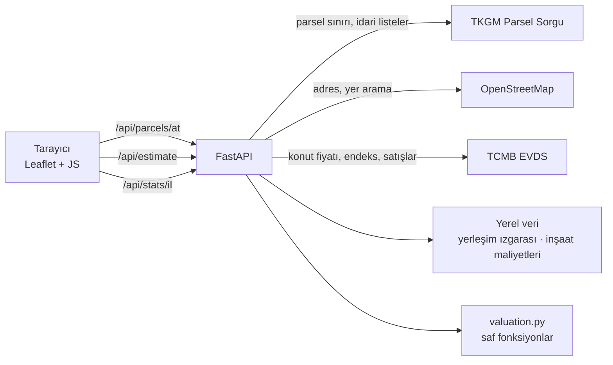

# Değerix

[](https://github.com/kayaal34/degerix/actions/workflows/tests.yml)

Haritada bir arsaya tıklayın ya da ada/parsel numarasını girin. Değerix parseli
**TKGM kaydından** bulur, sınırını haritada çizer ve değerini **resmî verilerle**
hesaplar: Merkez Bankası'nın güncel konut fiyatları, Bakanlığın inşaat maliyetleri
ve uydu nüfus verisinden çıkarılan yerleşim sınıfı. Sonuç tek bir rakam değil;
**acil satış, piyasa değeri ve tok satıcı** fiyatları, değer aralığı ve hesabın
adım adım dökümüdür.

**Teknolojiler:** Python 3.12 · FastAPI · httpx · Leaflet · Vanilla JS · pytest · GitHub Actions

## Özellikler

- **Haritadan seçim:** tıklanan noktadaki gerçek parsel TKGM'den gelir: ada, parsel, yüzölçümü, nitelik ve sınır poligonu.
- **Ada / parsel ile arama:** il → ilçe → mahalle listeleri de TKGM'den gelir.
- **Resmî veriye dayalı model:** değer, lisanslı değerleme uzmanlarının kullandığı geliştirme (artık değer) yöntemiyle hesaplanır; girdiler TCMB, Resmî Gazete ve uydu verisidir.
- **Şehir ile köyü ayırt eder:** parselin 1 km²'lik hücresi "şehir merkezi · yoğun kentsel küme · kasaba · şehir çeperi · köy · kırsal" olarak sınıflanır.
- **Arsa soruları:** imar durumu ve emsal (KAKS, inşaat alanı canlı hesaplanır), müstakil/hisseli tapu (hisse payının değeri ayrıca gösterilir), yol cephesi, elektrik ve su, deniz/göl manzarası, köşe parsel (imarlı arsada), sulu/kuru (imarsız arazide). Sorular yalnızca ilgili durumda görünür; zeytinlikte yasal kısıt uyarısı çıkar.
- **Parsel çevresi:** kıyıya ve ana yola mesafe, 1 km içindeki okul/sağlık/market noktaları ve eğim otomatik ölçülür. Ölçüm 4 saniyede yetişmezse değer beklemeden gösterilir.
- **Satış süresine göre fiyat:** acil satış (1–2 ay), piyasa değeri (3–6 ay) ve tok satıcı (6 ay+) için ayrı fiyat ve aralık.
- **Bölge analizi:** TCMB EVDS'den ilin konut m² fiyatı, bölge konut fiyat endeksi (24 aylık grafik) ve son 12 ayın konut satışları.
- **Şeffaf hesap:** değer aralığı, güven düzeyi ve her adımın gerekçesi gösterilir. "Bilmiyorum" denen sorular aralığı genişletir.
- **Telefonda:** arsanın üzerindeyken "Bulunduğum yeri seç" ile parseli GPS'ten bulma, dokunmatik uyumlu arayüz.
- **Harita / Uydu düğmesi:** parsel seçilince uydu görüntüsü kendiliğinden açılır; kullanıcının kendi seçimi hatırlanır.
- **Yazdırılabilir / PDF rapor:** parsel krokisi, verilen yanıtlar, değer, senaryolar, bölge analizi ve hesabın tam dökümü tek sayfada.
- **İki parseli karşılaştırma:** değer, m² fiyatı, aralık ve senaryolar yan yana; liste yalnızca kullanıcının tarayıcısında saklanır.
- **Yer arama** (OpenStreetMap) ve **paylaşılabilir bağlantı:** bağlantı parselle birlikte yanıtları da taşır; açan kişi aynı sonucu görür.
- **Yedek akış:** parsel kaydı olmayan noktalarda il/ilçe OpenStreetMap'ten alınır, alanı kullanıcı girer.

## Nasıl çalışır?



Tarayıcı dış servislere doğrudan gitmez; FastAPI araya girer. Bunun üç faydası var:

- **Tutarsız yanıtlar tek yerde düzeltilir.** TKGM alanı bazen `45,911.00`, bazen `45.911,00` biçiminde döndürüyor; bazı adları da "Gölbaşi" gibi bozuk yazıyor.
- **Anahtar ve önbellek sunucuda kalır.** EVDS API anahtarı tarayıcıya hiç gitmez.
- **Hız sınırlarına uyulur.** Nominatim'in saniyede bir istek sınırı aşılmaz, Overpass sorguları paylaşılır.

## Değerleme modeli

Model, arsayı satın alacak kişinin mantığını kurar: **arsanın değeri, üzerine
yapılabilecek şeyin değerinden geriye kalandır.**

### 1. Bölgedeki konut fiyatı

```text
bölgedeki konut m² fiyatı = TCMB'nin il konut m² fiyatı × yerleşim katsayısı
```

TCMB'nin il fiyatı ağırlıklı olarak şehir merkezini yansıtır; yerleşim katsayısı bunu
parselin bulunduğu yere indirger:

| Yerleşim sınıfı | Katsayı | Örnek |
|---|---|---|
| Şehir merkezi | 1,05 | Kadıköy, Kızılay, Nilüfer |
| Yoğun kentsel küme | 0,85 | Mudanya, Bodrum |
| Şehir çeperi | 0,80 | büyük şehrin kenar mahalleleri |
| Kasaba | 0,70 | Alaçam ilçe merkezi |
| Köy | 0,50 | köy yerleşiği |
| Seyrek kırsal | 0,42 | |
| Çok seyrek kırsal | 0,36 | dağ köyleri, kırsal parseller |

Izgara 1 km çözünürlükte olduğu için sınıf sınırlarında sertlik oluşmasın diye hücrenin
katsayısı 2 km çevresindeki en kentsel sınıfla harmanlanır: köyün hemen kenarındaki parsel
bomboş kırsalla aynı sayılmaz. Parsel **il merkezinin içindeyse** katsayı il ortalamasının
(1,00) altına düşmez; TCMB'nin il fiyatı zaten ağırlıklı olarak o şehirden gelir.

Bunun ötesinde parselin sınıfı **erişilebilirliğe** göre de yükseltilir: çevredeki en kentsel
hücre, uzaklığına göre basamak basamak indirilerek devralınır ve ikisinden kentsel olanı
seçilir (`urbanity.access_class`). Hücrenin kendi nüfus yoğunluğu erişilebilirliği temsil
etmiyor — Gaziantep merkezine 8,6 km'deki boş bir parsel ızgarada "seyrek kırsal" görünüyor,
oysa orada fiyatı tarımsal verim değil şehre yakınlık belirliyor. Menzil kaynağın
kentselliğiyle oranlıdır: bir şehrin etkisi uzağa gider (basamak ≈ 6 km), bir köyün gitmez
(≈ 2,5 km), yoksa 6 km ötedeki köy 4 kişi/km² yoğunluklu bir hücreyi köy sınıfına çıkarırdı.
Izgarada olmayan kentsellik uydurulmaz; yalnızca var olan kentsellik sönümlenerek taşınır.

Sınıf **fiyat seviyesini** belirler, **inşaat hakkını** belirlemez: KAKS girilmemişse
varsayılan, erişilebilirlik sınıfından değil parselin kendi hücresinden okunur. Yakınlık arsayı
değerli yapar ama orada daha fazla inşaat hakkı doğurmaz. Aynı nedenle merkez ve büyükşehir
primleri, erişilebilirlik sınıfı parseli kentsel saydığı ölçüde kademeli olarak sıfıra iner:
aynı yakınlık iki kanaldan sayılırsa değer şehirden uzaklaştıkça yükselmeye başlıyor.

### 2. İmarlı arsa: geliştirme (artık değer) yöntemi

```text
yeni konut fiyatı = bölgedeki konut fiyatı × yeni konut primi (1,20)
hasılat           = inşaat hakkı × satılabilir oran (0,80) × yeni konut fiyatı
maliyet           = inşaat hakkı × Bakanlık yapı birim maliyeti
arsa              = hasılat − maliyet − geliştirici payı (hasılatın %15'i)
```

TCMB'nin fiyatı tüm konut stokunun (eski + yeni) ortalamasıdır; müteahhit ise yeni daire
satar ve yeni konut ortalamanın üstünde fiyatlanır. Bu fark **yeni konut primi** olarak
hesaba girer.

İnşaat maliyeti, Çevre ve Şehircilik Bakanlığının 2026 tebliğinden gelir. Yapı sınıfı
hem yerleşime hem de **bölgedeki konut fiyatına** bakılarak seçilir: konutun 25.000 ₺/m²'ye
satıldığı bir şehirde 21.000 ₺/m² maliyetli bina yapılmaz.

| Bölgedeki konut fiyatı | Konut | Ticari |
|---|---|---|
| 55.000 ₺/m² ve üzeri | III-B (21.050 ₺/m²) | III-C (23.400 ₺/m²) |
| 32.000 – 55.000 ₺/m² | III-A (19.800 ₺/m²) | III-B (21.050 ₺/m²) |
| 32.000 ₺/m² altı | II-C (15.100 ₺/m²) | III-A (19.800 ₺/m²) |
| Kırsal yerleşim (köy ve altı) | II-C, köy evi | III-A |

**Hasılat maliyeti karşılamıyorsa** (köylerde çoğu zaman böyledir) geliştirme hesabı
arsaya değer bırakmaz. O zaman değer "taban orandan" gelir: orada arsayı alan kişi
müteahhit değil, kendi evini yapacak kişidir. Taban oran, bölgedeki konut fiyatının
şehirde %10'u, köyde %3'ü, kırsalda %1,8'idir.

### 3. İmarsız arazi

Tarla, bağ-bahçe ve zeytinlik için iki okuma yapılır ve **büyüğü** alınır:

1. **Tarımsal değer** — bölgedeki konut fiyatının yerleşime ve kullanıma bağlı oranı
   (kırsalda %0,6 – şehir çeperinde %2; zeytinlikte 1,6 katı).
2. **İmar beklentisi** — aynı yerde parsel konut imarlı olsaydı edeceği değerin bir payı.

İkinci okuma, tarım açıklamasının anlamını yitirdiği yerde devreye girer: 472 m²'lik
bir "tarla"da ekilecek bir şey yoktur, alıcı toprağın verimini değil imara açılma
olasılığını satın alır. Ölçümde imarsız arazinin birim fiyatı 1 dönümün altında,
5-20 dönüm bandının **5 katı** çıkıyor; tek bir tarımsal oran bu farkı taşıyamaz.

Beklenti üç koşulu birlikte arar:

- **Parsel yapı parseli ölçeğinde olmalı** (400 m² altında tam, 5.000 m² üstünde hiç).
  342 dönümlük bir tarlaya konut imarı beklentisi uygulanamaz. Üst sınır ölçümle
  2.000'den 5.000 m²'ye çıktı: Kayapınar'da metropol ilçesindeki 3.400 m² "tarla"
  piyasada 4.136 ₺/m² ederken model 513 diyordu.
- **Büyümekte olan bir yerleşimin yanında olmalı** (3 km'ye kadar tam, 6 km'de sıfır).
  İmar beklentisi genişleyecek bir yerleşim ister.
- **Parselin kendi hücresi henüz yoğun kentsel olmamalı.** Çekirdekte hâlâ imarsız
  kalmanın bir sebebi vardır — sulak alan, tarımsal koruma, dere yatağı — ve o sebep
  yakınlıkla ortadan kalkmaz. Bu kuralı Bandırma/Kuşcenneti öğretti: korunan sulak
  alandaki 1.295 m² tarla piyasada 900 ₺/m² ederken model, hücreyi şehir merkezi
  gördüğü için 4.190 ₺/m² diyordu.

Büyüğü alındığı için bu hesap hiçbir araziyi ucuzlatmaz. Varsayımsal imarın getireceği
yoğunluk, parselin bugünkü kırsal hücresinden değil çevrenin sınıfından okunur: imarlı
arsada inşaat hakkı parselin yerine bağlı hukuki bir olguyken, burada henüz imar yoktur.

Ama çevrenin yoğunluğu **olduğu gibi** devralınmaz, **bir basamak indirilir**. Bunu
İzmir/Menderes öğretti: yoğun kümenin yanındaki 250 m² bağ-bahçe piyasada 1.144 ₺/m²
ederken model 7.610 ₺/m² diyordu. İmara açılacak bir parsel komşu kentin bugünkü
kademesini değil bir altını alır; 55 ilanda bu seçim imarsız arazinin tipik hatasını
0,82'den 0,77'ye indiriyor (`expectation_class_step`).

### 4. Düzeltmeler

Bulunan m² değeri şu çarpanlarla düzeltilir:

| Çarpan | Nasıl belirlenir | Aralık |
|---|---|---|
| Denize yakınlık | kıyı çizgisine mesafe (OpenStreetMap); 3 km ötesinde etkisiz | 1,00 – 1,20 |
| Ana yola erişim | en yakın ana yola mesafe (OpenStreetMap) | 0,90 – 1,05 |
| Çevre hizmetleri | 1 km içindeki okul, sağlık ve market noktası sayısı | 0,95 – 1,05 |
| Eğim | parselin çevresindeki yükselti farkı (Open-Meteo, Copernicus) | 0,85 – 1,00 |
| Merkeze yakınlık | yalnızca kırsalda: ilçe merkezine uzaklık | 1,00 – 1,20 |
| Büyüklük | büyük parselde m² fiyatı düşer | 0,65 – 1,08 |
| Tapu | hisseli tapuda ortaklık indirimi | 0,80 – 1,00 |
| Yol cephesi | yola cephesi yoksa geçit hakkı gerekir | 0,75 – 1,00 |
| Elektrik ve su | eksikse düşer; tarlada etkisi daha az | 0,85 – 1,00 |
| Manzara / köşe parsel | yalnızca yanıtlanınca uygulanır | 1,00 – 1,12 |
| Sulama (imarsız) | sulu arazi kuru araziden pahalıdır | 0,90 – 1,20 |
| Emsaller | kullanıcının girdiği ilan/satışların ortancası; ağırlık emsal sayısıyla artar (%20 → %60) | emsale göre |

**Değer aralığı ve veri tamlığı:** her eksik bilgi aralığı genişletir — yerleşim
bilgisi alınamaması, TCMB'nin o il için fiyat yayımlamaması, canlı veri yerine
kopya kullanılması ve "Bilmiyorum" denen her soru. Emsal girilmesi aralığı
_daraltır_; girilmemesi genişletmez. Kullanıcı yanıtladıkça aralık daralır ve
gösterilen veri tamlığı "düşük → orta → yüksek" olur. Bu ölçü girdilerin ne kadar
tam olduğunu anlatır, modelin gerçek isabetini değil — ölçülen sapma için
[Bilinen sınırlamalar](#bilinen-sınırlamalar) bölümüne bakın.

**Satış senaryoları:** piyasa değeri 3–6 aylık normal satışı temsil eder. Acil satışta
imarlı arsa ×0,85, imarsız arazi ×0,78 (arazi daha yavaş satılır); tok satıcıda
×1,08 / ×1,10 uygulanır.

Model deterministiktir: aynı girdiler her zaman aynı sonucu verir. Tek istisna
çevre ölçümleridir (kıyı, ana yol, hizmetler, eğim). Overpass ve Open-Meteo yanıtı
4 saniyede yetişmezse o çarpanlar hesaba girmez; bu yüzden aynı parsel için ardışık
iki istek farklı değer verebilir ve aralık bu durumda genişlemez.

### Örnekler (Eylül 2026)

**Samsun Alaçam, köy içi parsel · 700 m² · konut imarlı · emsal 0,50**

| Adım | Değer |
|---|---|
| Samsun konut m² fiyatı (TCMB) | ₺37.326 |
| Yerleşim: çok seyrek kırsal (10 kişi/km²) | × 0,36 → ₺13.437 |
| Geliştirme: 350 m² inşaat hakkı | hasılat maliyeti karşılamıyor → **değer bırakmıyor** |
| Taban değer (konut fiyatının %1,8'i) | ₺242/m² |
| Merkeze yakınlık (Yakakent 6,9 km) | × 1,10 |
| **Sonuç** | **₺182.000** (₺260/m²) · aralık ₺158.000 – ₺206.000 |

Aynı parselin ilan fiyatı 245.000 ₺ (350 ₺/m²). İlan, satıcının istediği fiyattır;
tahminin bir miktar altında kalması beklenir.

**Bodrum Yeniköy 1108 ada 6 parsel · 467,87 m² · konut imarlı**

| Adım | Değer |
|---|---|
| Muğla konut m² fiyatı (TCMB) | ₺82.290 |
| Yerleşim: yoğun kentsel küme | × 0,85 → ₺69.947 |
| Yeni konut primi | × 1,20 → ₺83.936 |
| Geliştirme: 561 m² inşaat hakkı (III-B) | hasılat ₺37,7M − maliyet ₺11,8M − pay ₺5,7M = ₺20,2M |
| **Sonuç** | **₺20.300.000** (₺43.400/m²) · güven yüksek |

### Modelin hassas noktası

Geliştirme yöntemi bir **fark** hesabıdır: hasılattan maliyet düşülür. Bu yüzden
girdilerdeki küçük değişim sonucu büyütür — hasılat %20 artarsa, maliyet sabitken
arsaya kalan tutar iki katına çıkabilir. Model bu nedenle üç noktada temkinli davranır:

- Yeni konut primi, satılabilir oran ve geliştirici payı ayrı ayrı parametredir; hepsi kalibre edilebilir.
- Arsa payı hasılatın %45'ini aşamaz (kat karşılığı uygulamasında arsa payı tipik olarak %20-40'tır).
- Hasılat maliyeti karşılamıyorsa değer sıfıra gitmez, taban orandan hesaplanır.

Yine de mutlak seviye, gerçek satış verisiyle kalibre edilene kadar bir tahmindir;
modelin iç tutarlılığı testlerle, ülke geneli davranışı `tools/province_sweep.py` ile denetlenir.

> **Neyi biliyoruz, neyi varsayıyoruz:** konut fiyatları, inşaat maliyetleri, parsel
> bilgileri ve nüfus verisi resmîdir. Yerleşim katsayıları, taban oranlar, arazi
> oranları ve geliştirici payı ise başlangıç varsayımıdır; `app/model_params.py`
> içinde durur ve gerçek satış verisiyle ayarlanmayı bekler (bkz. [Kalibrasyon](#kalibrasyon)).

## Veri kaynakları

| Kaynak | Ne için | Lisans / not |
|---|---|---|
| [TKGM Parsel Sorgu](https://parselsorgu.tkgm.gov.tr) | Parsel sınırı, alan, nitelik, idari listeler | Resmî olarak belgelenmemiş kamuya açık servis |
| [TCMB EVDS](https://evds3.tcmb.gov.tr) | İl konut m² fiyatı, konut fiyat endeksi, satış sayıları | Ücretsiz API anahtarı |
| Çevre ve Şehircilik Bakanlığı | 2026 yapı yaklaşık birim maliyetleri | Resmî Gazete, 3/2/2026, sayı 33157 |
| [WorldPop](https://www.worldpop.org) | 1 km nüfus ızgarası → yerleşim sınıfı | CC BY 4.0 |
| [GeoNames](https://www.geonames.org) | İl/ilçe merkezleri ve köyler | CC BY 4.0 |
| [OpenStreetMap](https://www.openstreetmap.org/copyright) | Kıyı, yollar, hizmet noktaları, yer arama, harita | ODbL |
| [Open-Meteo](https://open-meteo.com) | Yükselti (Copernicus DEM) → eğim | CC BY 4.0 |

Yerleşim sınıfları, Birleşmiş Milletler / Eurostat "kentleşme derecesi" (Degree of
Urbanisation) eşikleriyle üretilir; sınıf kodları GHS-SMOD ile aynıdır.

## Çalıştırma

Python 3.12 gerekir.

```bash
python -m venv .venv
```

```bash
.venv\Scripts\activate
```

```bash
pip install -r requirements.txt
```

```bash
uvicorn app.main:app --reload
```

- Tanıtım sayfası: <http://localhost:8000>
- Harita uygulaması: <http://localhost:8000/harita.html>
- API dokümanı (Swagger): <http://localhost:8000/docs>

### EVDS API anahtarı (isteğe bağlı)

Anahtar yoksa uygulama çalışır: konut fiyatları `app/static_data/konut_birim_fiyat.json`
içindeki kopyadan okunur, yalnızca bölge analizi kartı gizlenir.

1. [evds3.tcmb.gov.tr](https://evds3.tcmb.gov.tr) adresinde ücretsiz üye olun ve profil sayfanızdan API anahtarınızı kopyalayın.
2. [`.env.example`](.env.example) dosyasını `.env` adıyla kopyalayın.
3. Anahtarı `EVDS_API_KEY=` satırına tırnaksız yapıştırın ve sunucuyu yeniden başlatın.

`.env` git'e gönderilmez. Anahtar yalnızca sunucuda kullanılır, tarayıcıya gönderilmez.

### Veri dosyalarını yeniden üretmek

Statik veriler depoda hazır gelir. Güncellemek için:

```bash
pip install -r requirements-dev.txt
```

```bash
python tools/build_urbanity.py
```

```bash
python tools/build_settlements.py
```

```bash
python tools/build_housing_prices.py
```

Sırasıyla yerleşim ızgarasını (WorldPop), yerleşim listesini (GeoNames) ve konut fiyatı
kopyasını (EVDS, anahtar gerekir) üretirler.

### Telefondan denemek (aynı Wi-Fi)

```bash
uvicorn app.main:app --host 0.0.0.0 --port 8000
```

Bilgisayarın yerel IP adresini `ipconfig` ile öğrenin (ör. `192.168.1.34`) ve telefonda
`http://192.168.1.34:8000` adresini açın. "Bulunduğum yeri seç" düğmesi tarayıcı kuralı
gereği yalnızca **https** üzerinde çalışır.

## Yayınlama (Render)

Depoda hazır bir [`render.yaml`](render.yaml) bulunur.

1. [render.com](https://render.com)'a GitHub hesabıyla giriş yapın.
2. **New → Blueprint** seçip bu depoyu bağlayın.
3. Render `EVDS_API_KEY` değerini sorar; boş bırakırsanız bölge analizi kapalı kalır.
4. Her `git push` sonrası otomatik güncellenir.

Ücretsiz planda servis 15 dakika istek almazsa uyur; sonraki ilk açılış yaklaşık bir dakika sürer.

## Kalibrasyon

Model katsayıları (`app/model_params.py`) başlangıç varsayımıdır. Gerçek kayıtlarla
ayarlanmaları planlanır:

- `data/pilot/bursa.csv` — belediye ihaleleri, KAP değerleme raporları ve belediye birim değerleri gibi **kaynağı belli, kamuya açık** kayıtlar (depoda).
- `data/private/` — ilan sitelerinden elle derlenen doğrulama kayıtları. **Git'e gönderilmez**; ham ilan verisi yeniden yayımlanmaz, kişisel veri tutulmaz. İlan fiyatı satış fiyatı olmadığı için ayrı bir pazarlık payı parametresiyle karşılaştırılır.

Uygulamadaki **emsal girişi**, girilen emsalleri kalibrasyon betiğinin beklediği sütunlarla
CSV olarak dışa aktarır; dosya doğrudan `data/private/` içine konabilir.

Kalibrasyon sonucu yalnızca katsayı olarak (`app/static_data/calibration.json`) depoya girer.

`tools/calibrate.py` yalnızca `konum=parsel` kayıtlarını kullanır ve her geçişin
sonucunu ölçüp **en iyisini** yazar — fit tek yönlü yakınsamadığı için "son geçiş"
doğru cevap değildir; hiçbir geçiş varsayılanı geçemezse varsayılan kalır. Koordinatı mahalle
merkezi olan kayıtlarda yerleşim sınıfı parselin değil köy çekirdeğinin ölçümüdür ve
katsayı sınıf başına ayarlandığı için sapma yanlış sınıfa yazılır. Sapma ayrıca
modelin katsayıyı **gerçekten okuduğu** sınıfa yazılır — hücrenin ham sınıfına değil,
erişilebilirlikle oluşan etkin sınıfa. İkisi ayrıldığından beri ham sınıfı kullanmak
her geçişte yanlış katsayıyı oynatıyordu.

## Araçlar

| Komut | Ne yapar |
|---|---|
| `python tools/sanity_check.py` | Örnek noktalarda modeli çalıştırır; şehir > çeper > kasaba > köy > kırsal gibi kuralları doğrular |
| `python tools/province_sweep.py` | 81 il merkezinde aynı parseli hesaplar, uç değerleri ve taban orana düşen illeri işaretler |
| `python tools/calibrate.py` | Gerçek kayıtlarla modelin hatasını ölçer; `--uygula` ile katsayıları yazar. Yalnızca `konum=parsel` kayıtlarını kullanır |
| `python tools/ilan_karsilastir.py` | `data/private/` altındaki gerçek ilanları emsalsiz tahminle karşılaştırır; koordinat hassasiyetine göre ayrı özet verir (`--detay` her ilanı listeler) |
| `python tools/build_urbanity.py` | WorldPop nüfus ızgarasından yerleşim sınıflarını üretir |
| `python tools/build_settlements.py` | GeoNames'ten il/ilçe merkezi ve köy listesini üretir |
| `python tools/build_housing_prices.py` | TCMB'den il konut fiyatlarının yedek kopyasını üretir |

Veri hazırlama betikleri `requirements-dev.txt` gerektirir; uygulama çalışırken bunlara
ihtiyaç duyulmaz. Üretilen dosyalar `app/static_data/` altında depoda durur.

## Testler

```bash
pytest
```

Testler ağa çıkmadan çalışır; TKGM, Nominatim, EVDS, OpenStreetMap ve yükselti servisi
sabit verilerle taklit edilir. Her push'ta GitHub Actions üzerinde de çalışır. Kapsananlar:

- **Değerleme modeli:** geliştirme hesabının tutarlılığı, köy/şehir farkı, taban değere düşme, imarsız arazi, determinizm, güven düzeyleri
- **Yerleşim verisi:** ızgara okuma, sınıflar, en yakın il/ilçe merkezi ve köy, Türkiye dışı noktalar
- **Konut fiyatı:** canlı EVDS, kopyaya düşme, fiyat yayımlanmayan iller
- **İnşaat maliyetleri:** yapı sınıfının kullanım, yerleşim ve konut fiyatı bandına göre seçilmesi
- **Yerleşim katsayısı:** sınıf harmanlama, il merkezi kuralı, kırsalda merkeze yakınlık
- **Emsaller:** pazarlık payı, büyüklük düzeltmesi, ağırlık sınırı, aralığın daralması
- **Akıl sağlığı:** şehirden kırsala sıralama, konut > tarla, emsal arttıkça değerin artması
- **Çevre ölçümleri:** kıyıya ve yola mesafe, katsayı sınırları, eksik ölçümler, önbellek, süre sınırı
- **Bölge analizi:** 81 ilin seri eşleştirmesi, dönem hesapları, kısmi ve tam servis kesintisi
- **API:** yedek akışlar, 404/422/502/503 yanıtları

## API

| Metot | Yol | Açıklama |
|---|---|---|
| GET | `/api/parcels/at?lat=&lng=` | Koordinattaki parsel; kayıt yoksa OSM adresi (`source: "osm"`) |
| GET | `/api/parcels/{mahalle_id}/{ada}/{parsel}` | Ada/parsel ile parsel |
| POST | `/api/estimate` | Tahmin, döküm ve satış senaryoları (gövde aşağıda) |
| GET | `/api/stats/{il}` | Bölge analizi; EVDS anahtarı yoksa 503 |
| GET | `/api/provinces` · `/api/provinces/{id}/districts` · `/api/districts/{id}/neighborhoods` | İdari listeler |
| GET | `/api/search?q=` | Yer arama |
| GET | `/api/usages` | İmar durumları (`zoned`: emsal sorulur mu) |
| GET | `/api/boundaries/{districts\|neighborhoods}/{ust_id}` | İlçe veya mahalle sınırları (GeoJSON) |
| GET | `/api/listings/nearby?lat=&lng=` | Yakındaki satılık arsa ilanları (Tapusor; anahtar yoksa 503) |
| GET | `/api/health` | Servis durumu (`stats`: bölge analizi açık mı, `listing_feed`: ilan bağlantısı açık mı) |

`/api/estimate` gövdesi:

```json
{
  "province": "Muğla", "area_m2": 467.87, "usage": "konut",
  "lat": 37.0385, "lng": 27.419,
  "kaks": 1.5, "deed": "hisseli", "share_pct": 25, "road": "var", "utilities": "kismen"
}
```

Yanıt; `base_label` (Geliştirme hesabı · Taban değer · Arazi değeri), `basis`,
`settlement`, `housing` (kullanılan konut fiyatı ve kaynağı), `development`
(inşaat hakkı, maliyet, hasılat, geliştirici payı), `factors`, `scenarios` ve
`confidence` alanlarını içerir.

Seçenekli alanların değerleri:

- `deed`: `tam` · `hisseli` · `bilinmiyor`
- `road`: `var` · `yok` · `bilinmiyor`
- `utilities`: `var` · `kismen` · `yok` · `bilinmiyor`
- `view`: `var` · `yok` · `bilinmiyor` — `corner`: `evet` · `hayir` · `bilinmiyor` — `irrigation`: `sulu` · `kuru` · `bilinmiyor`

Konum ve sorular isteğe bağlıdır. Hata yanıtları `{"detail": "Türkçe açıklama"}` biçimindedir:

| Kod | Durum |
|---|---|
| 404 | Kayıt yok (parsel, adres ya da tanınmayan il) |
| 422 | Girdi geçersiz |
| 502 | Dış servise ulaşılamadı |
| 503 | Bölge analizi kapalı (EVDS anahtarı yok) |

## Proje yapısı

```text
app/
  main.py           FastAPI uç noktaları ve şemalar
  valuation.py      değerleme modeli (saf fonksiyonlar)
  model_params.py   ayarlanabilir katsayılar; kalibrasyonla güncellenir
  market.py         il konut m² fiyatı: canlı EVDS, yoksa kopya
  costs.py          Bakanlık yapı yaklaşık birim maliyetleri
  urbanity.py       yerleşim sınıfı, yoğunluk, en yakın merkezler
  surroundings.py   çevre katsayıları: kıyı, ana yol, hizmetler, eğim
  nearby.py         Overpass ve yükselti ölçümleri + önbellek
  tkgm.py           TKGM istemcisi + önbellek
  nominatim.py      OpenStreetMap istemcisi (hız sınırlı)
  evds.py           TCMB EVDS istemcisi ve bölge analizi
  evds_series.py    81 il için EVDS seri kodları
  geo.py            mesafe, poligon merkezi ve alanı
  data.py           soru seçenekleri, senaryolar, Türkçe ad eşleştirme
  static_data/      yerleşim ızgarası, yerleşim listesi, konut fiyatı kopyası
static/             tanıtım sayfası ve harita uygulaması
tools/              veri hazırlama betikleri (rasterio, numpy, scipy gerekir)
data/pilot/         Bursa pilot veri seti şablonu ve derleme kuralları
tests/              pytest
render.yaml         Render yayın tanımı
```

## Bilinen sınırlamalar

- **Doğrulama verisinin üçte birinde koordinat parselin değil mahalle merkezinin.** Bu, modelin ölçülen isabetini olduğundan iyi gösteriyordu ve projenin en önemli ölçüm kısıtıydı. 81 geçerli kaydın 27'sinde `konum` sütunu `mahalle`: o kayıtlarda yerleşim sınıfı, yerleşime uzaklık ve erişilebilirlik parselin değil köy çekirdeğinin ölçümüdür. Fark hâlâ ölçülebilir — mahalle merkezli kayıtlarda ortanca oran **0,84**, gerçek parsel koordinatlarında **1,05**. `tools/calibrate.py` yalnızca `konum=parsel` kayıtlarını kullanır; bu kısıt 15 kayıtla kalibrasyonu tamamen durdururken, 54 kayıtla artık durdurmuyor.
- **Kalibrasyon artık iki katsayıyı ayarlıyor.** Parsel pinli kayıt sayısı 15 → 28 → **54** oldukça (Kasım 2026'da sahibinden'den 46 yeni ilan) `MIN_RECORDS_PER_CLASS` eşiğini geçen sınıf sayısı da arttı: `locality` şehir merkezinde 1,05 → **1,3127** (14 kayıt), yoğun kentsel kümede 0,85 → **0,9688** (14 kayıt). Kalan sınıflar — `farmland_ratio`'nun tamamı dahil — hâlâ varsayımdır. Ölçülen etki: parsel pinli kayıtlarda ortanca sapma %81,7 → **%65,4**, ±%25 içinde kalan %18,5 → **%25,9**. Şehir merkezi katsayısının bu kadar yükselmesinin anlamı şudur: TCMB'nin il ortalaması ucuz ilçeleri de içerdiği için şehir çekirdeğindeki arsa piyasasını olduğundan düşük gösteriyor.
- **Bağımsız ölçüm (15 ilden 81 gerçek ilan, Kasım 2026).** `tools/ilan_karsilastir.py` ilan fiyatlarını emsalsiz tahminle karşılaştırır; hedef, `tools/calibrate.py` ile aynı: ilan fiyatı × (1 − pazarlık payı). Koordinatı gerçek parsel olan **54 kayıtta** ortanca oran **1,05** ve ortalama |log₂ oran| **0,96**; ilanların **yarısından fazlası** (29/54) modelin verdiği ±%50 bandının içinde. Oturum başında bu küme 15 kayıt ve 1,47 ortancaydı. Tüm 81 kayıtta ortanca oran 0,98, |log₂| 0,90. Hepsi istenen fiyattır, gerçekleşen satış değil.
- **Değer aralığı ölçülen hataya oturtuldu, 81 ilanın 45'ini kapsıyor.** Aralığın yarı genişliği artık yöntemin gerçek isabetinden gelir (geliştirme ±%45, taban ±%50, imarsız arazi ±%70, imar beklentisi ±%85) ve emsal girildiğinde değerle aynı ağırlıkla daralır. Öncesinde taban ±%8'di ve aralık 42 ilanın yalnızca 9'unu kapsıyordu; kullanıcıya gösterilen güven aralığı modelin gerçek isabetinden üç kat dardı. Arayüzdeki etiket de bu yüzden "Veri tamlığı" değil **"Tahmin güveni"**.
- **Taban oranlar, geliştirici payı ve çevre çarpanları kalibre edilmez.** `tools/calibrate.py` yalnızca `locality` ve `farmland_ratio` katsayılarını ayarlar; diğerleri varsayımdır.
- **Arsa değeri, artık değer yönteminin ima ettiği kadar emsale duyarlı değil — ve çözüm denendi, işlemedi.** Aynı ilçede (İstanbul/Çatalca ile Silivri, ikisi de "kasaba" sınıfı) model 2.530 ile 23.100 ₺/m² arasında **on kat** ayrışıyor çünkü biri KAKS 0,10 beyan etmiş. Piyasa ise 12.602 ile 7.785 diyor, yani 1,6 kat. Yeni veri aynı kalıbı emsale göre sıralı olarak gösteriyor: Ankara/Pursaklar (emsal 1,40) ve Sincan (emsal yok, varsayılan 1,50) **3,6 kat yüksek**, Ankara/Çankaya (emsal 0,25) ve İzmir/Çeşme (emsal 0,40) **5 kat düşük**. Önerilen çözüm — geliştirme sonucunu konuma dayalı bir çıpaya harmanlamak — bu kez ölçüldü: en iyi ağırlıkta (w=0,15) geliştirme kayıtlarının tipik hatası 1,02'den 0,96'ya iniyor ama ortanca oran ve parsel pinli alt küme bozuluyor. Sebebi ölçülebilir: çıpanın kendisinde yerel bilgi yok. İl ortalaması × sınıf oranı, Çankaya ile Pursaklar'ı ayırt edemiyor — ikisi de ızgarada "şehir merkezi". Gerçek engel harmanlama ağırlığı değil, **ilçe bazında konut fiyatının olmayışıdır**.
- **İmarsız arazi, gerçek parsel koordinatlarında hâlâ %16 düşük.** Parsel pinli 26 imarsız kayıtta ortanca oran **1,16** (parsel ölçeği sınırı 5 dönüme çıkmadan önce 1,46'ydı). Kalan açığı kalibrasyon kapatamıyor çünkü sapma tek bir sınıfta toplanmıyor — yoğun kentsel kümede en büyük — ve `farmland_ratio` bantları sınıf başına 5 kayıtla bu kadar savrulmaya izin vermiyor. Doğrusu da bu: altı kayıttan öğrenip ülkenin tarlasını üç katına çıkarmak ölçüm değil, kumar olurdu.
- **Erişilebilirlik basamağı (6 km) ölçüldü, yerinde kaldı.** Ankara/Pursaklar ve Sincan'ın fazla pahalı çıkması, parselin uzaktaki şehirden devraldığı sınıfın fazla cömert olduğunu düşündürdü. Basamak uzunluğu 2 ile 8 km arasında tarandı: kısaltmak her ölçütü bozuyor (2 km'de parsel pinli ortanca oran 1,81, tipik hata 1,47), 5-8 km bandı ise birbirine denk. Yani o iki kaydın sorunu erişilebilirlik değil, Ankara'nın il ortalamasıyla fiyatlanan ucuz ilçeleri. Katsayı değiştirilmedi.
- **Diyarbakır Kayapınar kapandı, İzmir/Menderes açık kaldı.** Kayapınar'daki 472 m² hisseli parsel (imarı "Arazi" beyan edilmiş) 6,98 kat düşükten **0,99**'a indi; aynı ilçedeki 770 m² parsel 1,08. Üç adımda oldu: imar beklentisi mekanizması, şehir merkezi `locality` katsayısının 54 kayıtla ayarlanması, parsel ölçeği sınırının 5 dönüme çıkması. Aynı ilçedeki 3.400 m² parsel ise hâlâ 6,21 kat düşük — sınırın içinde ama kıyısında, beklentinin yalnızca üçte biri uygulanıyor. Ters yöndeki örnek de açık: İzmir/Menderes'teki 250 m² bağ-bahçe piyasada 1.144 ₺/m² ederken model 6.820 diyor. Tek bir kayıt için mekanizmayı daha fazla zorlamak, doğru çalıştığı kayıtları bozardı.
- **İl geneli konut fiyatı, baskın bir birinci şehri olan illerde uzak ilçelere yanlış taban veriyor.** TCMB EVDS il düzeyinde yayın yapıyor; İstanbul'un 90.740 ₺/m² değeri şehrin kendisinden geliyor ve Silivri gibi 56 km uzaktaki ilçelerde değeri yukarı çekiyor (ölçümde 1.300 m²'lik Silivri parselinde model, hedefin 3 katı). Bu bir katsayı sorunu değil veri sorunudur: ilçe düzeyinde konut fiyatı gerekiyor.
- **TKGM API'si** resmî olarak belgelenmemiştir; biçim değişebilir ve yoğun kullanımda istek sınırına takılabilir.
- **Nüfus ızgarası 2020 yılına aittir.** Hızlı büyüyen yeni yerleşimlerde sınıf gerçeğin gerisinde kalabilir.
- **Nitelik ≠ imar durumu:** nitelikten tahmin edilen imar durumu bir öneridir; gerçek imar durumu ve emsal belediyeden öğrenilmelidir.
- **EVDS arsa fiyatı yayımlamaz;** model konut fiyatından yola çıkar. Üç aylık birim fiyatlar küçük illerde az sayıda işleme dayandığı için dalgalanabilir.
- **Harita altlıkları** (OpenStreetMap karoları, Esri uydu görüntüsü) düşük trafikli kullanım içindir.

## Yol haritası

- **Kalibrasyon:** pilot ve doğrulama kayıtlarıyla katsayıların ayarlanması, hata payının ölçülüp yayımlanması
- **Öğrenen katman:** yeterli kayıt biriktiğinde kural katmanının sapmasını düzelten bir model
- **Emsal girişi:** kullanıcının bulduğu ilan fiyatlarından bölge ortalaması

## Yasal uyarı

Değerix bir portfolyo projesidir. Sunulan tahminler bilgilendirme amaçlıdır; yatırım
tavsiyesi değildir ve SPK lisanslı gayrimenkul değerleme raporu yerine geçmez.
## Türkiye keşfi ve ilan geçmişi

Ana sayfadaki **Türkiye’yi keşfet** bağlantısı 81 ilde konut birim fiyatlarını ve bölgesel TCMB konut fiyat endeksini açar. Endeks grafiği Ekim 2024–Eylül 2026 döneminin yayımlanmış aylık değerlerini gösterir. İl seçildiğinde bölgeye dahil diğer iller de belirtilir. Parsel aramasının Türkiye kapsamı sürer.

Arşivdeki ilk dokuz taşınmaz Bursa Orhaneli Belediyesinin 15 Eylül 2026 tarihli ihalesindendir. Kaynak ilan ve TKGM parsel kaydı aynı ekrandan açılır. Gösterilen bedel ihale öncesi muhammen bedeldir.

Bir sağlayıcıdan alınan tarihli ilan gözlemlerini eklemek için UTF-8 CSV sütunları `url,title,province,district,date,status,price` olmalıdır. Aynı ilan için sabit HTTPS adresini, YYYY-MM-DD tarihini ve tam TL tutarını kullanın. Durum `Aktif` veya `Kaldırıldı` olabilir. Kaldırılan ilanlarda bedel boş kalabilir. Bir kaydın sonraki dosyada görünmemesi durumunu değiştirmez.

`python tools/import_listings.py gozlemler.csv` komutu kayıtları `static/listings.json` içinde birleştirir. Bu dosyayı siteyle yayımlayın. Aynı günün aynı gözlemi tekrar eklendiğinde çoğaltılmaz. Çelişen gözlemler dosya yazılmadan bildirilir.
## Parsel çevresindeki ilanlar

Parsel kartında **Yakındaki satılık arsa ilanları** bölümünü açın. Durum, yarıçap ve son görülme dönemini seçip **Tapusor’da ara** düğmesine basın. Her sayfa 20 kayıt ister. Son görülme dönemi sağlayıcının tanımına göre bugünü dışarıda bırakır. İlk ve son fiyatlar istenen fiyatlardır. Kalkan bir ilan satış sonucunu kanıtlamaz. Koordinatı olan ilanlar haritada işaretlenir. Fiyatı ve alanı verilen bir ilanı kullanıcı kendi seçimiyle değerlemeye emsal ekleyebilir.

Canlı sorgu için sunucunun ortamında veya yerel `.env` dosyasında `TAPUSOR_CLIENT_ID` ve `TAPUSOR_CLIENT_SECRET` tanımlayın ve uygulamayı yeniden başlatın. Tapusor hesabının v2 ilan duyuruları ürününe erişimi ve kredisi gerekir. Sunucu aynı sorgu sayfasını 15 dakika bellekte tutar. Sorgu kullanıcı düğmeye bastığında çalışır. Her yeni sorgu sayfası sağlayıcının tarifesine tabidir. Halka açık kurulumda bu API rotasını kendi kullanıcı erişiminize ve sağlayıcı kotanıza göre sınırlandırın. [Sağlayıcı dokümantasyonu](https://www.ai.tapusor.com/public/api/?v=2#listing-announcements)

CSV arşiv aktarımında isteğe bağlı `lat,lng,neighborhood_id` sütunları kullanılabilir. Koordinatlar ilanı keşif haritasına yerleştirir. TKGM mahalle kimliği verildiğinde mahalle filtresi de çalışır. Eski CSV biçimi desteklenir.
Saatlik yeni sorgu sayısı her sunucu işlemi için `TAPUSOR_REQUESTS_PER_HOUR` ile ayarlanır (varsayılan 60). Önbellekten gösterilenler bu kotayı tüketmez.
